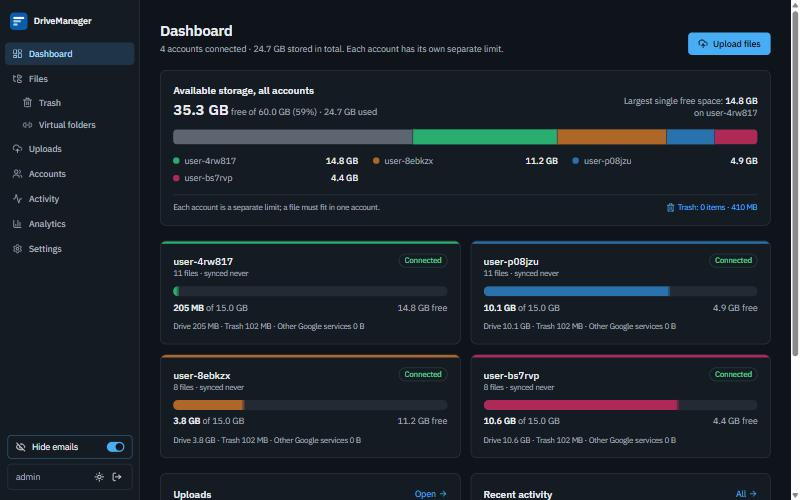

# DriveManager

A private, self-hosted dashboard for managing several Google Drive accounts in one place. It runs on your own Windows PC in Docker and talks to Google only through the official Drive API.



<sub>Screenshots use sample accounts with **Privacy mode** switched on.</sub>

## Features

**Storage at a glance**
* Every connected account's **own quota**, side by side: used, free, and how much is in the trash.
* One combined bar on the dashboard, plus the **largest single free space** (the biggest file you can actually upload, since a file is never split across accounts).
* Storage history and analytics: usage over time, what's taking space by file type, largest files, uploads per day. The charts follow the light/dark theme.

**Files**
* Browse and search **My Drive, Shared with me, Shared drives and Trash** across all accounts in one list.
* Filter by account and file type. Sort by name, account, date or size, either from the menu or by **clicking a column header** (click again to flip). Choose **Folders first, Files first or Mixed**; the choice is remembered.
* **Selecting files** shows a floating bar at the bottom (Add to virtual folder, Move to trash, Delete permanently; in Trash, Restore). The list doesn't move, and the bar stays visible while you scroll. **Esc** or ✕ clears the selection.
* **Shift + click** to select a range: tick one file, then Shift + click another file's checkbox (or the empty part of its row) to tick everything in between. Shift + unticking clears the range. Works on the current page.
* **Right-click** any file or folder (or long-press on phones) for the same actions as its ⋮ menu. If several items are selected, the menu acts on all of them. **Shift + right-click** still gives the browser's own menu.
* **Show all files**: a toggle that lists every file in every folder of the current tab as one flat list, with the folder each file is in shown under its name (click it to open the folder). Folders themselves are hidden there, and sorting and filters still apply, so "largest files anywhere" is one click. On by default; turning it off is remembered in your browser.
* Resizable columns: drag the edge, or double-click to fit. The **⋮ actions** button stays pinned to the right however wide the columns get.
* **Click a file's name** to choose **Download** or **Open in Drive**. Tick *Remember Download or Open in Drive until I reload the page* and later clicks do that straight away. **Share or copy link…** sits on its own line in the same prompt and is never remembered. This works in the Google Drive and Virtual folders tabs.
* Rename, move, create folders, download (Google Docs/Sheets/Slides export to Office or PDF).
* **Share…**: set *General access* to *Restricted* or *Anyone with the link* (Viewer, Commenter or Editor; never searchable), add **specific people** by email with a role and an optional notification email, and change or remove anyone's access. **Copy link** copies the Drive link and tells you who can open it.
* **Move to another account…** without downloading anything. DriveManager first **transfers ownership** to the other connected account (same file and link; comments and sharing kept). If Google doesn't allow that, it **copies the file inside Google** and moves the original to the old account's Trash. Single files only for now.
* **Move to trash**, restore, **Delete permanently** (from anywhere, with a two-step confirmation that lists every item and unlocks after a short countdown), and **Empty trash** per account or for all of them.
* **Search everything** from the sidebar (or the 🔍 icon on phones; shortcut **Ctrl + K** or **/**). Results show live on the Files page: files and folders from every account, My Drive, Shared with me and shared drives, at any depth.
* **Resizable sidebar** (desktop): drag its right edge to make it wider or narrower. Drag it all the way left for an **icons-only** strip, and double-click the edge to switch back. Remembered in your browser; reset from Settings → Sidebar.
* **Customisable sidebar**: **pin** items to a group at the top (hover the pin icon, or right-click / long-press for Pin, Move up and Move down); pinned items can't be dragged. Dashboard is pinned by default, and the default order is Dashboard, Uploads, Files, Trash, Accounts, Virtual folders, Activity, Analytics. **Settings** is the gear icon at the bottom, between the theme switch and Sign out. Drag the others to reorder them (or **Alt + ↑/↓**). **Settings → Sidebar** lists every item with Pin and ↑/↓ buttons, which also works on phones, plus **Reset order and pins**. Saved on the server, so it's the same on every device. On phones, pinned items stay visible on the left while the rest of the top bar scrolls.
* **Sync now** in the sidebar re-indexes every connected account at once, and shows progress while the syncs run. Accounts also sync on their own schedule.

**Uploads**
* Live progress, **automatically** (the default) or to an account you choose: routing rules by file type or name, then your account priority. A file is never split, and an account you chose is never silently swapped for another.
* Uploads **resume** after network drops or restarts and **never duplicate**. Failed uploads can be retried, also on another account.
* Optionally **add each upload to a virtual folder** as soon as it finishes.
* One blue **Upload files** button in the sidebar, above Search (the upload icon in icons-only mode and in the phone top bar), opens an upload dialog. It starts in the folder you're browsing (with *Choose an account* selected); otherwise it starts on *Automatic*; in a virtual folder, "Also add to virtual folder" is preselected. Elsewhere it uses the defaults. On the Uploads page it's greyed out, since that page has its own upload form.
* **Drag files from your computer** anywhere onto DriveManager (desktop, every page except Uploads): the window shows *Drop files to upload* with where they'd go, and dropping opens the Upload dialog with the files attached. Review or change the destination, then press **Upload**. Dropped folders are skipped, with a note.
* A **progress panel** at the bottom right, like Google Drive's, shows every upload from this session: where each file goes (**→ account · My Drive / Work / Projects**, or *Choosing account…* while Automatic decides, with the reason on hover), progress rings, ✓ and a folder button that opens the file's folder in Files. It stays until you close it, and ⌄ collapses it. **Failed** uploads explain what went wrong, and ↻ offers *Same account (try again)* (when the account isn't the problem) or another connected account with enough space. Files that never reached the server can be re-sent while the page is open. Uploads keep going while you move between pages.

**Virtual folders**
* Your own folder tree of links to files across accounts. Nothing moves in Google Drive.

**Privacy and security**
* **Privacy mode**: a sidebar switch that replaces every email address in the app with a stable alias (e.g. `user-k3f9x2`). Handy for screenshots and screen sharing. Display only: nothing changes on the server.
* **Fake file and folder names** (Settings → Developer): shows every file, folder, shared drive and virtual folder name as a made-up name built from ordinary words (e.g. *Quarterly Garden Plan.pdf*). The same name always gets the same fake name, and the extension and icon stay. Display only and saved per browser: search still matches the real names, and sizes and storage are real. A **Demo** badge shows in the sidebar while it is on. Combine it with Privacy mode for recordings.
* Single local user with a hashed password, CSRF and origin checks, and Google refresh tokens encrypted at rest. Tokens are redacted from logs.
* Activity history, plus backup and restore scripts.

DriveManager keeps accounts as separate quotas. It does not merge them into one big drive.

## Quick start (Windows 10/11)

1. Install and start **Docker Desktop**.
2. Open **PowerShell** in this folder and run:
   ```powershell
   scripts\setup.ps1     # creates secrets, asks for a username and password
   scripts\start.ps1     # builds, starts and opens http://localhost:8000
   ```
   (If PowerShell refuses to run scripts: `Set-ExecutionPolicy -Scope Process Bypass`, then try again.)
3. Create your Google credentials once by following **[docs/GOOGLE_OAUTH.md](docs/GOOGLE_OAUTH.md)**. Put them in `.env` (or re-run `scripts\setup.ps1`), then run `scripts\start.ps1` again.
4. Sign in, open **Accounts**, and click **Connect account**.

The first start builds the images and can take several minutes. Back up regularly with `scripts\backup.ps1`.

## Updating

`scripts\update.ps1` rebuilds from the files in this folder, so pull the latest code first:

```powershell
git switch main
git pull
scripts\update.ps1    # backs up, rebuilds the images, restarts; database migrations run automatically
```

Then reload the app in your browser. **Settings → About** shows which build you're running: the git commit, linked to GitHub, and the build time. It also has links to the repository, the docs, the license and *Report a problem*. Your data lives in Docker volumes and is not touched by an update.

## Logs

The backend and worker write rotating log files (`backend.log`, `worker.log`; 5 MB each, 5 old copies kept) to the `drivemanager_drive_manager_logs` Docker volume. Tokens, passwords and the client secret are redacted. Email addresses and file names are not, since **Privacy mode** only changes what's on screen.

```powershell
scripts\logs.ps1            # follow live output of all services (Ctrl+C to stop)
scripts\logs.ps1 worker     # just one: backend, worker or frontend
scripts\get-logs.ps1        # copy everything into .\logs\ to read or share
```

`get-logs.ps1` saves `logs\backend.log` and `logs\worker.log`, plus `logs\console.log` with recent output from every container. That includes the frontend (nginx), which has no log file of its own. Add `-Tail 0` to include all console output Docker still has. The `logs\` folder is git-ignored. Docker clears console output when containers are recreated (for example by an update), but the log files are kept.

Which to check: **worker** for uploads, syncs and storage refreshes; **backend** for anything that failed when you clicked it; **frontend** only if the page doesn't load at all. Errors that happen inside the page itself show up in the browser console (F12 → Console), not in these logs.

## Documentation
| | |
|---|---|
| [docs/GOOGLE_OAUTH.md](docs/GOOGLE_OAUTH.md) | Step-by-step Google Cloud setup (read the 7-day token note) |
| [docs/DOCKER.md](docs/DOCKER.md) | Operating it: volumes, updating, backup/restore, HTTPS, troubleshooting |
| [docs/ARCHITECTURE.md](docs/ARCHITECTURE.md) | How it works: uploads, deleting, virtual folders, Privacy mode, fake names, security model |
| [docs/DATABASE.md](docs/DATABASE.md) | Tables and migrations |
| [docs/API.md](docs/API.md) | HTTP API, including query parameters for file listing and uploads |

## Project layout
```
docker-compose.yml  .env.example
.github/workflows/ CI: backend tests + frontend build on every pull request and push to main
docker/        Dockerfiles + nginx configs (backend, worker, frontend)
backend/       FastAPI app (app/), Alembic migrations, tests
  app/api  app/core  app/database  app/integrations/google_drive  app/services  app/workers  app/websocket
frontend/      React + TypeScript + Vite + Tailwind
scripts/       setup / start / stop / logs / get-logs / backup / restore / update / make-cert (PowerShell)
logs/          Copies of the logs made by scripts\get-logs.ps1 (git-ignored)
docs/          Documentation and screenshots
```

## Development
```powershell
# backend tests (Python 3.11+; CI uses 3.12). Dependencies are read from backend/pyproject.toml, like CI and the Dockerfiles do.
cd backend
python -c "import tomllib; p = tomllib.load(open('pyproject.toml', 'rb'))['project']; print('\n'.join(p['dependencies'] + p['optional-dependencies']['dev']))" > requirements-dev.txt
pip install -r requirements-dev.txt; pytest

# frontend type-check and production build (Node 22)
cd frontend; npm ci; npm run build
```

For a local backend, set the variables from `.env.example` in your shell (at least `APP_SECRET_KEY`, `APP_ENCRYPTION_KEY`, `APP_PASSWORD_HASH`, `DATABASE_URL`, `STAGING_DIR`, `LOG_DIR`), run `alembic upgrade head`, then `uvicorn app.main:app`. `npm run dev` proxies to a backend on **:8000**. If your Docker instance is already using that port, run the dev backend on another port and add the dev origin (e.g. `http://localhost:5173`) to `ALLOWED_ORIGINS`.

## Testing and CI
GitHub Actions runs on every pull request and every push to `main`. It runs the backend test suite (50 tests: auth/CSRF/origin, encryption and log redaction, allocation rules, file index queries and sorting, deleting and emptying trash, virtual folders including uploads into them, the upload runner against a simulated Google, sync including cursor recovery), plus a TypeScript type-check and a production frontend build.

Everything Google-facing is tested against fakes, so real Google API behaviour is only exercised when you run it. If something misbehaves, see [Logs](#logs) below.

## Known limitations
No pause button for uploads (cancel, retry and auto-resume exist). Folders can't be moved between accounts yet (single files can). Ownership transfer only works between personal Google accounts or inside one Workspace organisation; otherwise a move falls back to a copy with a new link. Single user. Google-native exports are limited to ~10 MB by Google. The app must be opened at the registered redirect address (`http://localhost:8000`) to connect accounts.

## License
[MIT](LICENSE) © 2026 FluffyCyanNova. You may use, change and share it, including commercially, as long as the copyright notice stays with it. It comes with no warranty.

Third-party packages keep their own licenses (mostly MIT, plus Apache-2.0 for Google's API client and the SIL Open Font License for IBM Plex Sans). Each install needs its own Google Cloud OAuth credentials (see [docs/GOOGLE_OAUTH.md](docs/GOOGLE_OAUTH.md)); none are included in this repository.
